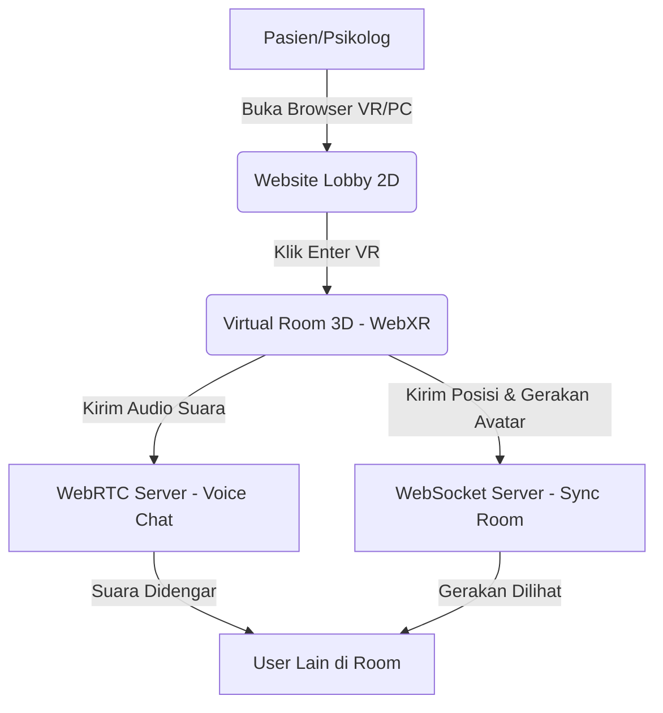

# Panduan Dasar Pengembangan Virtual Reality (VR) untuk Pemula
*Khusus untuk Project Kolaborasi Psikologi & Teknologi*

Dokumen ini menjelaskan dasar-dasar teknologi VR, perbedaan antara metode pengembangan native dan web, serta alasan mengapa WebXR sangat cocok untuk aplikasi terapi virtual psikolog-pasien.

---

## 1. Bagaimana Cara Kerja VR?
Secara sederhana, headset VR (seperti Meta Quest, Pico, atau Apple Vision Pro) adalah **komputer kecil berbasis Android** yang dipasang di kepala. 

Sebuah aplikasi VR bekerja dengan cara:
1.  **Rendering Stereoskopis**: Menampilkan dua gambar 3D yang sedikit berbeda untuk mata kiri dan mata kanan guna menciptakan ilusi kedalaman (efek 3D nyata).
2.  **Head & Controller Tracking**: Menggunakan sensor gyroscope, akselerometer, dan kamera internal pada headset untuk mendeteksi posisi kepala dan tangan secara real-time. Jika pengguna menengok ke kanan, visual 3D di dalam layar akan ikut bergeser ke kanan tanpa jeda (low latency).

---

## 2. Dua Kubu Pengembangan VR

Dalam membuat aplikasi VR, developer biasanya memilih salah satu dari dua jalur berikut:

### A. Native VR (Unity / Unreal Engine)
Aplikasi dibuat menggunakan game engine dan di-compile menjadi file mentah aplikasi (contoh: `.apk` untuk Android VR standalone seperti Quest/Pico, atau `.exe` untuk PCVR).
*   **Kelebihan**: Kualitas grafis sangat tinggi, performa maksimal, akses penuh ke hardware canggih (seperti *eye tracking*, *hand tracking*, atau sensor detak jantung).
*   **Kekurangan**: Proses instalasi rumit bagi pengguna awam (harus *sideloading* menggunakan PC atau SideQuest), ukuran file besar, dan waktu *build/compile* yang cukup lama saat development.

### B. WebXR (Web-based VR - A-Frame / Three.js / React Three Fiber)
Aplikasi dibuat menggunakan teknologi web standar (HTML, CSS, JavaScript) dan diakses langsung melalui browser bawaan di dalam kacamata VR.
*   **Kelebihan**:
    *   **Zero-Installation**: Pengguna tidak perlu menginstal apa pun. Cukup ketik URL (seperti membuka website biasa) di browser VR, lalu klik tombol **"Enter VR"**.
    *   **Multiplatform**: Bisa dibuka di kacamata VR, laptop, tablet, maupun HP biasa.
    *   **Mudah Di-update**: Jika ada perubahan kode, developer cukup mengunggahnya ke server, dan semua pengguna akan langsung mendapatkan versi terbaru saat halaman direfresh.
    *   **Kemudahan Sinkronisasi**: Protokol komunikasi real-time seperti Voice Chat (WebRTC) dan sinkronisasi gerakan (WebSockets) lebih mudah diterapkan karena menggunakan infrastruktur web yang sudah matang.
*   **Kekurangan**: Kualitas grafis dibatasi oleh performa browser (tidak se-detail game console), dan performa bergantung pada kestabilan koneksi internet serta performa browser di headset.

---

## 3. Mengapa WebXR Sangat Cocok untuk Aplikasi Terapi Psikologi?

Untuk project kolaborasi psikolog dan pasien ini, WebXR adalah pilihan terbaik bahkan hingga versi rilis penuh (full production), karena:

1.  **Aksesibilitas Pasien yang Tinggi**: Pasien terapi biasanya adalah orang awam yang tidak terbiasa menginstal aplikasi VR tidak resmi. Dengan WebXR, psikolog cukup mengirimkan link ruang terapi virtual, dan pasien bisa masuk dengan sekali klik.
2.  **Dukungan Mode Non-VR (Hybrid)**: Pasien yang tidak memiliki kacamata VR atau sedang mengalami kendala teknis tetap bisa berpartisipasi menggunakan laptop atau smartphone (tampilan 3D first-person).
3.  **Kemudahan Kolaborasi & Demo**: Saat melakukan bimbingan dengan dosen atau melakukan pengujian dengan fakultas psikologi, Anda bisa mendemonstrasikannya dengan sangat mudah tanpa harus membawa laptop gaming atau menginstal file APK ke setiap headset satu per satu.

---

## 4. Gambaran Arsitektur Sistem (Masa Depan)

Dokumen ini dibuat untuk mempermudah diskusi awal dengan dosen pembimbing mengenai arah teknologi yang akan digunakan dalam project.
