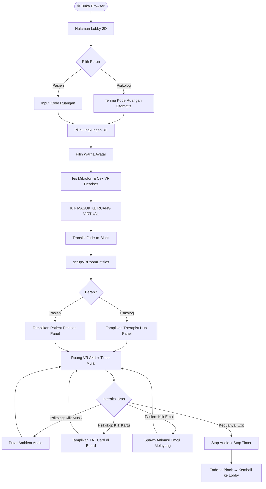
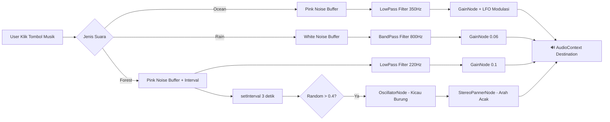
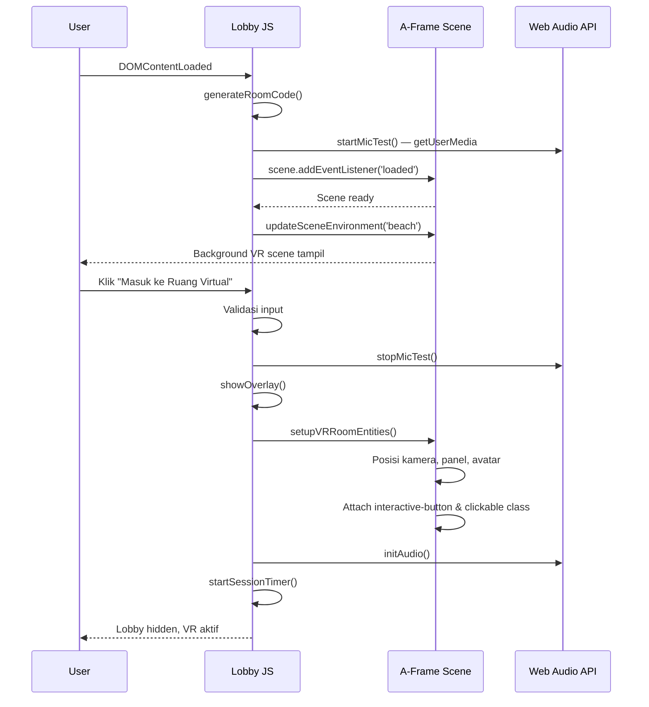

# 🌸 TranquilVR — Virtual Reality Therapeutic Space

> Ruang terapi virtual berbasis WebXR untuk komunikasi psikolog–pasien secara real-time di lingkungan 3D imersif.

---

## 📖 Daftar Isi

1. [Deskripsi Proyek](#deskripsi-proyek)
2. [Fitur Utama](#fitur-utama)
3. [Teknologi yang Digunakan](#teknologi-yang-digunakan)
4. [Cara Kerja Sistem](#cara-kerja-sistem)
5. [Alur Pengguna (User Flow)](#alur-pengguna-user-flow)
6. [Flowchart Sistem](#flowchart-sistem)
7. [Struktur File & Penjelasan](#struktur-file--penjelasan)
8. [Cara Menjalankan Proyek](#cara-menjalankan-proyek)
9. [Arsitektur Teknis](#arsitektur-teknis)
10. [Rencana Pengembangan ke Depan](#rencana-pengembangan-ke-depan)

---

## Deskripsi Proyek

**TranquilVR** adalah aplikasi ruang terapi virtual berbasis web (WebXR) yang dirancang untuk memungkinkan seorang **Psikolog** dan **Pasien** bertemu secara virtual di lingkungan 3D yang tenang dan imersif. Aplikasi ini berjalan sepenuhnya di dalam browser, tanpa perlu menginstal software apapun — cukup buka URL di browser VR atau desktop.

Proyek ini dikembangkan sebagai demonstrasi kolaborasi antara **ilmu psikologi** dan **teknologi web modern**, menggabungkan terapi berbasis eksposur lingkungan virtual dengan antarmuka interaktif spatial (3D).

### Keunggulan Utama
- ✅ **Zero-Installation** — Berjalan langsung di browser
- ✅ **Multi-Platform** — Kompatibel dengan VR headset, laptop, tablet, dan HP
- ✅ **Procedural Audio** — Suara ambient (ombak, hujan, hutan) dibuat real-time via Web Audio API
- ✅ **Spatial UI** — Antarmuka tombol melayang di dalam ruang 3D
- ✅ **Dual Role System** — Mode terpisah untuk Psikolog dan Pasien

---

## Fitur Utama

### 🏠 Lobby (Antarmuka 2D)
| Fitur | Deskripsi |
|-------|-----------|
| **Pemilihan Peran** | Pilih sebagai Psikolog atau Pasien |
| **Nama Pengguna** | Input nama yang akan tampil di sesi |
| **Kode Ruangan** | Psikolog mendapat kode unik; Pasien memasukkan kode untuk bergabung |
| **Pemilih Lingkungan** | Pilih tema ruang 3D: Pantai, Hutan, atau Kuil Bintang (khusus Psikolog) |
| **Warna Avatar** | Pilih dari 4 warna avatar (Teal, Indigo, Rose, Amber) |
| **Status Perangkat** | Deteksi mikrofon aktif dengan visualizer gelombang, dan deteksi VR headset |
| **Simulasi Partner (Demo Mode)** | Aktifkan simulasi partner otomatis (pergerakan, pernapasan, aksi) untuk solo-testing |

### 🌐 Ruang VR (Antarmuka 3D Spatial)
| Fitur | Peran | Deskripsi |
|-------|-------|-----------|
| **Therapist Hub Panel** | Psikolog | Kontrol musik ambient (Ocean/Rain/Forest) dengan *smooth crossfade*, kartu emosi, dan tombol *Breathing Guide* |
| **Express Emotion Panel** | Pasien | Tombol reaksi emoji (😊, 😰, 😢, 😌) yang akan melayang naik dengan efek *organic drift particle* |
| **Breathing Guide (Metronome)** | Keduanya | Bola visual penuntun napas (siklus 4-4-4-4: Inhale, Hold, Exhale, Hold) di tengah ruangan |
| **Mood Light & Atmosphere** | Keduanya | Pencahayaan ambient yang berubah warna secara halus mengikuti emosi kartu yang aktif |
| **Settings Panel** | Keduanya | Timer sesi, kode ruangan, mute mikrofon, tombol exit sesi |
| **TranquilBoard** | Keduanya | Papan tulis virtual yang menampilkan kartu terapi emosi (TAT Cards) |
| **Partner Avatar** | Keduanya | Avatar 3D sederhana dengan animasi melayang (bobbing), mata yang hidup, dan simulasi AI (jika Demo Mode aktif) |
| **Lingkungan 3D** | Keduanya | Preset pemandangan imersif (arches/forest/starry) dari A-Frame Environment Component |

---

## Teknologi yang Digunakan

### Core Stack
| Teknologi | Versi | Fungsi |
|-----------|-------|--------|
| **HTML5** | — | Struktur halaman & A-Frame scene markup |
| **CSS3** | — | Glassmorphism lobby UI, animasi, responsive layout |
| **JavaScript (ES Module)** | ES2022 | Logika aplikasi, state management, event handling |
| **Vite** | ^5.2.0 | Dev server & build tool dengan HMR |

### VR & 3D
| Library | Versi | Fungsi |
|---------|-------|--------|
| **A-Frame** | ^1.7.1 | Framework WebXR untuk membangun scene 3D deklaratif di HTML |
| **A-Frame Environment Component** | 1.3.3 | Menghasilkan lingkungan 3D lengkap (langit, terrain, pepohonan, pencahayaan) dari satu preset |
| **Three.js** | (bundled via A-Frame) | Engine 3D WebGL yang mendasari A-Frame |
| **WebXR API** | Browser native | Mendukung mode VR immersive di headset Meta Quest, Pico, dll. |

### Audio
| API | Fungsi |
|-----|--------|
| **Web Audio API** | Membuat suara ambient prosedural (bukan file audio — semua dihasilkan matematis) |
| **BufferSourceNode** | Memutar buffer noise (pink/white) sebagai dasar suara alam |
| **BiquadFilterNode** | Filter frekuensi untuk membentuk karakter suara (lowpass=ombak, bandpass=hujan) |
| **OscillatorNode** | LFO modulasi volume ombak & synthesizer kicau burung |
| **StereoPannerNode** | Panning kiri-kanan untuk efek suara burung spatial 3D |
| **AnalyserNode** | Analisis frekuensi mic untuk visualizer bar di lobby |

### Font & Design
| Resource | Fungsi |
|----------|--------|
| **Google Fonts — Outfit** | Font display untuk logo dan UI 2D lobby |
| **Google Fonts — Plus Jakarta Sans** | Font body untuk teks deskripsi di lobby |
| **A-Frame kelsonsans** | Font bawaan A-Frame untuk semua teks 3D di dalam VR scene |

---

## Cara Kerja Sistem

### 1. Inisialisasi Aplikasi
Saat halaman dibuka, script `app.js` menginisialisasi state global, mendeteksi kemampuan WebXR browser, memulai tes mikrofon otomatis, dan menghasilkan kode ruangan acak (format: `TRQ-XXX-AAA`).

### 2. Konfigurasi di Lobby (2D)
Pengguna mengisi konfigurasi di tiga panel:
- **Panel 1**: Memilih peran → mengubah tampilan UI secara dinamis (psikolog dapat kode, pasien input kode)
- **Panel 2**: Memilih lingkungan → langsung mengubah preset A-Frame Environment di background
- **Panel 3**: Memilih warna avatar → mengubah warna avatar partner secara real-time di scene 3D

### 3. Transisi Masuk VR
Saat tombol "MASUK KE RUANG VIRTUAL" diklik:
1. Overlay fade-to-black muncul
2. `setupVRRoomEntities()` dipanggil: memposisikan kamera, avatar, dan panel sesuai peran
3. Lobby disembunyikan dengan animasi fade-out
4. Audio context diaktifkan (wajib setelah user gesture per browser policy)
5. Timer sesi dimulai

### 4. Interaksi di Dalam VR
- Cursor mouse/gaze di-raycast ke objek 3D yang memiliki class `.clickable`
- Hover → tombol membesar dan berubah biru
- Klik → efek suara klik + eksekusi fungsi (putar audio, tampilkan kartu, spawn emoji)
- Avatar partner menghadap user secara real-time via komponen `look-at-camera`

### 5. Exit Sesi
Tombol "Exit Session" → audio berhenti → timer berhenti → fade-to-black → lobby muncul kembali → tes mic dimulai ulang.

---

## Alur Pengguna (User Flow)

### Alur Psikolog
```
Buka Website → Pilih "Psikolog" → Catat Kode Ruangan → 
Pilih Lingkungan → Pilih Warna Avatar → Klik "Masuk ke Ruang Virtual" →
[Ruang 3D] → Putar Musik Ambient → Tampilkan Kartu Emosi →
Pantau Reaksi Pasien → Akhiri Sesi
```

### Alur Pasien
```
Buka Website → Pilih "Pasien" → Input Kode Ruangan dari Psikolog →
Pilih Warna Avatar → Klik "Masuk ke Ruang Virtual" →
[Ruang 3D] → Lihat Kartu Emosi di Papan → 
Klik Tombol Reaksi Emoji → Akhiri Sesi
```

---

## Flowchart Sistem

### Flowchart Utama



### Flowchart Audio Engine



### Flowchart Inisialisasi Scene



---

## Struktur File & Penjelasan

```
c:/TheGame/Money/VR/
│
├── 📄 index.html                    ← Entry point utama aplikasi
├── 📄 app.js                        ← Seluruh logika JavaScript aplikasi
├── 📄 style.css                     ← Styling lengkap untuk UI 2D lobby
├── 📄 package.json                  ← Konfigurasi npm & dependencies
├── 📄 package-lock.json             ← Lock file versi dependencies
├── 📄 README.md                     ← Dokumentasi proyek ini
│
├── 📄 Plan A.md                     ← Dokumen rencana awal UI & fitur proyek
├── 📄 Panduan Dasar VR.md           ← Panduan teknologi VR untuk pemula / dosen
│
├── 📁 public/                       ← Aset statis disajikan langsung oleh Vite
│   ├── 📄 aframe.min.js             ← Library A-Frame v1.7.1 (offline, ~1.3MB)
│   └── 📄 aframe-environment-component.min.js  ← Komponen preset lingkungan 3D
│
└── 📁 node_modules/                 ← Dependensi npm (diinstall otomatis, tidak di-commit)
    └── vite/                        ← Dev server & bundler
```

### Detail Setiap File

#### `index.html`
File HTML utama yang menjadi tulang punggung keseluruhan aplikasi. Berisi **dua layer** yang saling tumpuk:
- **Layer 2D (z-index: 1000)**: `#lobby-container` — form konfigurasi sesi dengan glassmorphism
- **Layer 3D (z-index: 1)**: `<a-scene>` — seluruh world WebXR dengan entity-entity A-Frame

Struktur A-Frame di dalamnya:
- `<a-entity id="scene-environment">` — lingkungan 3D prosedural (gunung, pohon, langit)
- `<a-entity id="camera-rig">` — rig kamera user dengan look-controls & WASD
- `<a-entity id="partner-avatar">` — avatar 3D lawan bicara dengan animasi bobbing
- `<a-entity id="shared-board">` — papan tulis virtual TranquilBoard
- `<a-entity id="therapist-control-panel">` — panel kontrol Psikolog (visible by role)
- `<a-entity id="patient-expression-panel">` — panel ekspresi Pasien (visible by role)
- `<a-entity id="universal-settings-panel">` — panel pengaturan universal (timer, mute, exit)

#### `app.js`
File JavaScript (ES Module) utama. Berisi semua logika aplikasi tanpa framework tambahan. Dibagi menjadi beberapa bagian:

| Seksi | Baris | Fungsi |
|-------|-------|--------|
| **State Management** | 1–19 | Objek `state` global (dilengkapi demoMode & breathingActive) |
| **Environment Presets** | 20–36 | Mapping nama lingkungan ke preset A-Frame environment |
| **Synthesized Sounds** | 37–276 | Engine audio prosedural dengan dukungan smooth crossfading |
| **Dynamic Mood Light Transitions** | 277–337 | Fungsi `transitionMoodLight` dengan requestAnimationFrame |
| **Visual Guided Breathing** | 338–409 | Siklus bernapas metronome (Inhale, Hold, Exhale, Hold) |
| **Partner AI Simulation / Demo Mode** | 410–501 | Simulasi pernapasan avatar, menoleh, dan memicu aksi acak |
| **Mic Analyzer** | 502–583 | Tes mikrofon lobby dengan visualizer bar real-time |
| **A-Frame Components** | 584–687 | Registrasi komponen `look-at-camera`, `interactive-button`, dan `floating-emoji` |
| **Lobby Init** | 688–837 | DOMContentLoaded handler & event listener UI 2D (Lobby) |
| **Transition Flow & State Handlers** | 838–1032 | Fungsi transisi lobby ke VR (`enterVRRoomFlow`) & penataan kamera/posisi (`setupVRRoomEntities`) |
| **VR Interactions** | 1033–1228 | Event listener & handler tombol spatial 3D di dalam VR scene |

#### `style.css`
Stylesheet lengkap untuk semua UI 2D lobby. Menggunakan **design token** via CSS Custom Properties (variables). Tidak ada Tailwind — pure vanilla CSS.

| Seksi | Elemen |
|-------|--------|
| Design System & Variables | Warna, font, shadow, transition tokens |
| A-Frame Canvas Override | Force full-screen canvas 100vw × 100vh |
| Lobby Container & Wrapper | Glassmorphism overlay, flex layout |
| Config Grid (3 Kolom) | Responsive grid, breakpoint 1024px |
| Role Selector | Card button aktif dengan glow warna berbeda per role |
| Room Code Display | Monospace display kode sesi |
| Environment Picker | Grid 3 tombol dengan state aktif |
| Avatar Color Dots | Lingkaran warna dengan border glow saat aktif |
| Device Status | Status mikrofon + bar visualizer animasi |
| Demo Mode Toggle | Custom toggle switch dengan style glassmorphism |
| Enter Button | Gradient teal-to-indigo dengan shimmer effect hover |
| Transition Overlay | Full-screen fade + spinner loading |
| Keyframe Animations | fadeInUp, fadeIn, float, spin, pulse |

#### `package.json`
Konfigurasi npm proyek. Mendeklarasikan:
- `"type": "module"` — menggunakan ES Modules secara native
- `vite` sebagai dev dependency (dev server + bundler)
- `aframe` sebagai dependency runtime

#### `Plan A.md`
Dokumen perencanaan awal proyek yang menjelaskan konsep, user journey, komponen UI yang direncanakan, dan perbandingan teknologi WebXR vs Native VR (Unity/Unreal). Cocok dibagikan ke dosen pembimbing.

#### `Panduan Dasar VR.md`
Dokumen edukasi tentang cara kerja teknologi VR, perbedaan Native VR vs WebXR, dan alasan WebXR dipilih untuk proyek ini. Berguna untuk presentasi ke non-technical stakeholder (mahasiswa psikologi, dosen).

#### `public/aframe.min.js`
Build minified dari A-Frame v1.7.1 yang disimpan lokal agar aplikasi bisa berjalan **tanpa koneksi internet** (offline-capable). Ukuran: ~1.3 MB.

#### `public/aframe-environment-component.min.js`
Plugin A-Frame yang menambahkan komponen `environment` — mampu menghasilkan scene 3D lengkap (pegunungan, pepohonan, langit, fog, pencahayaan) hanya dengan satu atribut `preset`. Preset yang digunakan: `arches` (Pantai), `forest` (Hutan), `starry` (Kuil Bintang).

---

## Cara Menjalankan Proyek

### Prasyarat
- Node.js v18+ terinstal
- Browser modern (Chrome, Edge, Firefox, Brave)

### Langkah-langkah

```bash
# 1. Clone atau buka folder proyek
cd c:/TheGame/Money/VR

# 2. Install dependencies (hanya pertama kali)
npm install

# 3. Jalankan dev server
npm run dev
# Atau jika ada masalah execution policy di Windows:
powershell -ExecutionPolicy Bypass -Command "npm run dev"

# 4. Buka browser ke:
# http://localhost:5173/
```

### Build Production
```bash
npm run build
# Output ke folder /dist — siap di-deploy ke hosting
```

### Catatan Penggunaan di VR Headset
1. Pastikan PC dan headset (Meta Quest, Pico, dll.) terhubung ke jaringan **WiFi yang sama**
2. Jalankan dev server dengan flag `--host`:
   ```bash
   npx vite --host
   ```
3. Buka URL Network yang muncul (misal: `http://192.168.1.10:5173`) di browser headset
4. Klik tombol "Masuk ke Ruang Virtual" lalu klik ikon VR di pojok kanan bawah scene

---

## Arsitektur Teknis

### State Management Pattern
Seluruh state aplikasi disimpan dalam satu objek `state` global yang menjadi **single source of truth**. Tidak ada framework reaktif — perubahan state dilakukan secara imperatif lalu DOM/A-Frame diperbarui secara langsung.

```javascript
const state = {
  role: 'psychologist',    // Peran aktif user ('psychologist' | 'patient')
  username: '...',         // Nama pengguna
  roomCode: 'TRQ-XXX-AAA', // Kode ruangan sesi
  environment: 'beach',    // Preset lingkungan aktif
  avatarColor: 'teal',     // Warna avatar pilihan
  isInVR: false,           // Flag apakah user sudah di VR scene
  micMuted: false,         // Status mute mikrofon
  activeBgm: null,         // Musik ambient aktif ('ocean' | 'rain' | 'forest')
  activeCard: null,        // Kartu emosi aktif ('love' | 'worry' | 'calm')
  sessionStartTime: null,  // Timestamp awal sesi
  timerInterval: null,     // ID interval timer sesi
  demoMode: false,         // Flag mode simulasi partner otomatis (AI)
  breathingActive: false   // Status aktif metronome visual pernapasan
};
```

### Komponen A-Frame Kustom

**`look-at-camera`**: Komponen yang dijalankan setiap frame (tick) untuk memutar entity (kepala avatar) agar selalu menghadap ke arah kamera user. Penting untuk avatar terasa "hidup".

**`interactive-button`**: Menambahkan efek hover (biru + scale 1.05) dan press (scale 0.95) pada semua tombol 3D. Juga memutar suara klik prosedural via Web Audio API saat tombol ditekan.

**`floating-emoji`**: Mengatur pergerakan emoji reaksi pasien agar melayang naik secara organik dengan translasi gelombang sinus pada sumbu X dan Z, rotasi acak pelan, serta fade-out opacity secara lembut berdasarkan waktu hidup partikel.

### Audio Architecture
```
AudioContext
├── BufferSourceNode (looping noise)
│   └── BiquadFilterNode
│       └── GainNode (volume)
│           └── AudioDestination (speaker)
│
└── OscillatorNode (bird chirp, per-event)
    └── GainNode (fade envelope)
        └── StereoPannerNode (random L/R pan)
            └── AudioDestination
```

---

## Rencana Pengembangan ke Depan

| Fitur | Teknologi | Status |
|-------|-----------|--------|
| **Voice Chat Real-time** | WebRTC (peer-to-peer audio) | 🔜 Planned |
| **Sinkronisasi Avatar** | WebSocket (posisi & rotasi kepala) | 🔜 Planned |
| **Lebih Banyak Lingkungan** | A-Frame Environment presets tambahan | 🔜 Planned |
| **Rekaman Sesi** | MediaRecorder API | 🔜 Planned |
| **Mode Mobile (non-VR)** | Touch controls A-Frame | 🔜 Planned |
| **Sistem Autentikasi** | Backend Node.js + JWT | 🔜 Planned |
| **Laporan Sesi Otomatis** | Export PDF dari timeline sesi | 🔜 Planned |

---

## 👩‍💻 Tentang Proyek

Proyek ini dikembangkan sebagai **demonstrasi teknologi** untuk membuktikan bahwa platform terapi virtual yang aksesibel dapat dibangun menggunakan teknologi web standar tanpa biaya lisensi software 3D. Dirancang agar dapat dipresentasikan langsung di depan dosen atau komite penguji dengan membuka URL di browser — tanpa setup, tanpa instalasi.

---

*Dibuat dengan ❤️ menggunakan A-Frame + Web Audio API + Vanilla JavaScript*
