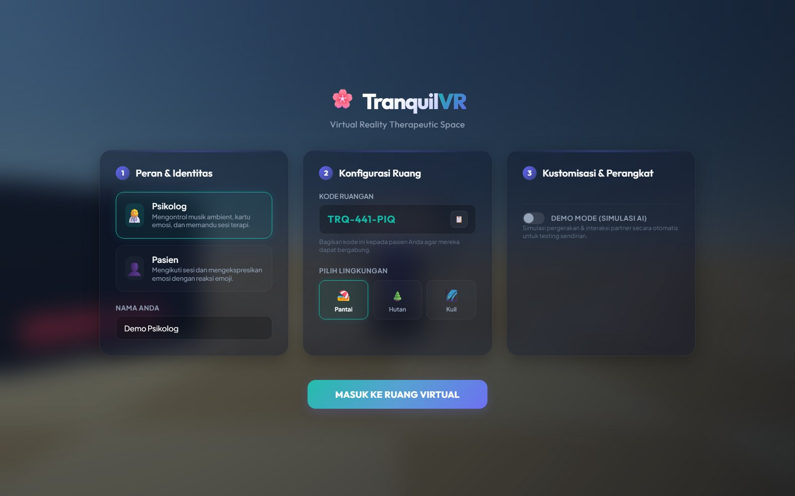

# TranquilVR — WebXR Therapy Space

     

> Prototipe ruang terapi browser-based dengan lobby, role psikolog/pasien, lingkungan 3D, dan audio prosedural.

## Preview



*Screenshot lobby lokal, diambil 25 November 2026 dengan nama demo. Tidak masuk sesi terapi atau menguji headset; koneksi WebSocket dan akses mikrofon tidak digunakan.*

## Tentang proyek

Prototipe ruang terapi browser-based dengan lobby, role psikolog/pasien, lingkungan 3D, dan audio prosedural. Dokumentasi ini dibuat sebagai panduan singkat untuk memahami ruang lingkup proyek, menjalankannya secara lokal, dan membaca batasan penggunaannya.

## Fitur utama

- Mode psikolog dan pasien
- Kode ruangan dan demo partner
- Preset lingkungan 3D
- Breathing guide visual
- Audio ambient prosedural
- Dukungan VR dan desktop

## Teknologi

- A-Frame
- WebXR
- Vite
- Three.js
- Web Audio API
- WebSocket

## Menjalankan secara lokal

Prasyarat dan konfigurasi dapat berbeda menurut sistem operasi. Contoh langkah utama:

```bash
npm install
npm run dev
```

## Struktur dan pengembangan

Mulai dari entry point dan folder konfigurasi proyek. Pisahkan credential lokal dari source code, tambahkan test untuk perubahan penting, dan gunakan environment variable untuk konfigurasi deployment.

## Keamanan

- Jangan commit API key, password, token, session ID, atau data pribadi.
- Gunakan file environment lokal dan contoh konfigurasi tanpa nilai rahasia.
- Uji perubahan pada environment development sebelum deployment.

## Status

Proyek ini merupakan bagian dari portofolio **Hilman Arifin Ilham** dan dapat dikembangkan sesuai kebutuhan penggunaan.

> **Catatan:** Ini adalah demonstrasi teknologi dan bukan perangkat terapi atau alat diagnosis klinis.

## Lisensi

Belum ada lisensi open-source yang dinyatakan di repository ini. Hubungi pemilik repository sebelum menggunakan ulang atau mendistribusikan kode.

---

Dibuat oleh [Hilman Arifin Ilham](https://github.com/hilman-devop).
